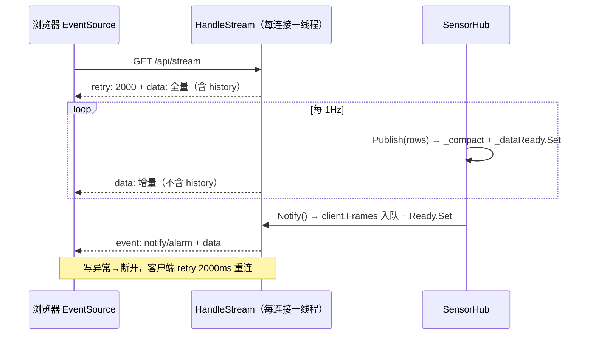
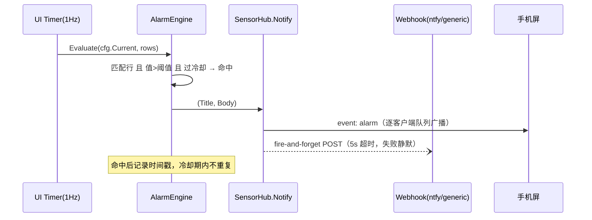
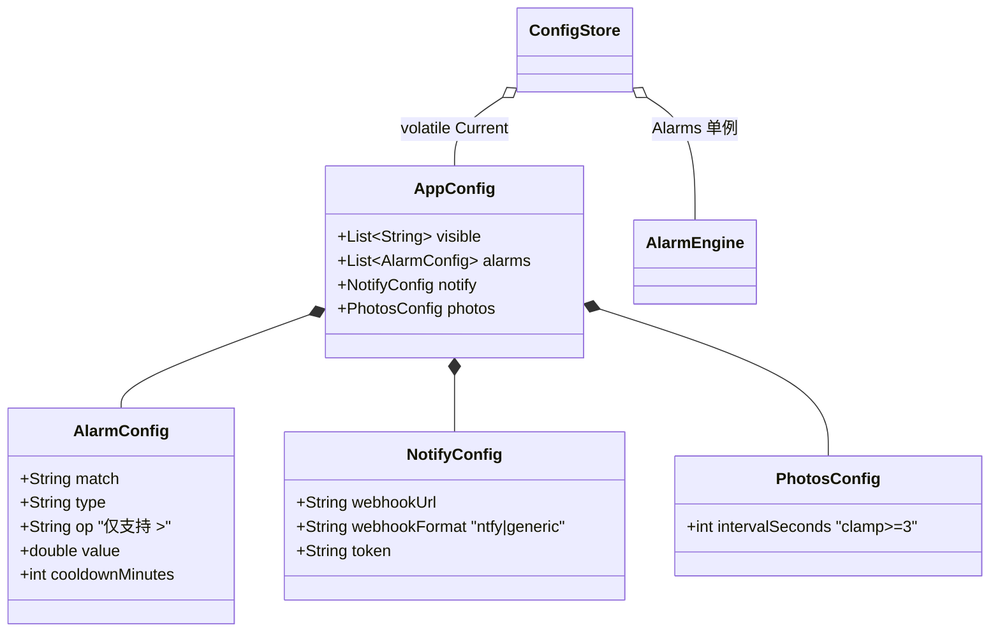

# HardwarePanel 架构与数据结构

> 需求与功能清单见 [REQUIREMENTS.md](REQUIREMENTS.md)。
> 结构图（可编辑）：[diagrams/architecture.drawio](diagrams/architecture.drawio)（组件与部署）、[diagrams/dataflow.drawio](diagrams/dataflow.drawio)（四条数据流）。

## 1. 总览

单进程 WinForms（.NET 8，requireAdministrator）+ 内嵌 `LibreHardwareMonitorLib`（WinRing0 驱动读 MSR/SuperIO）+ `HttpListener http://+:8080`（http.sys 代听）。UI 线程 1Hz 采集并发布快照；每浏览器连接一条阻塞式 SSE 循环推送增量与事件帧。

## 2. 源码文件职责

| 文件 | 职责 | 关键成员 |
|---|---|---|
| `Program.cs` | 入口、单实例互斥体 | `Global\HardwarePanel` Mutex；`--tray` 参数 |
| `MainForm.cs` | WinForms 宿主、采集编排、托盘、卸载 | `RefreshAll()`（采集→Render→Publish→Seed→告警）；`BuildTrayMenu()`；`Uninstall()` |
| `GpuCounters.cs` | Intel 核显性能计数器（使用率/专用/共享） | `Read()` → (util, dedicated, shared) |
| `VolumeLevel.cs` | 主音量读取（CoreAudio COM，失败返回 null） | `Read()` → 0–100 / null |
| `SensorHub.cs` | HTTP + SSE + 通知广播 + 静态文件/图片 | `Publish()`、`Handle` 路由、`HandleStream()`、`Notify()` |
| `ConfigStore.cs` | 配置模型与读写 | `Load/Save/Clamp/SeedDefaultVisible`、`Current`（volatile）、`Alarms` 单例 |
| `AlarmEngine.cs` | 阈值告警 | `Evaluate(cfg, rows)`、`ResetCooldowns()` |
| `AutoStartHelper.cs` | 开机自启计划任务 | `IsEnabled/Enable/Disable`（schtasks，任务名 `HardwarePanel`） |
| `wwwroot/index.html` | 信息屏（面板式，4 面板分组） | ES5 |
| `wwwroot/photos.html` | 图片轮播 | ES5 |
| `wwwroot/settings.html` | 配置页（宽版分组卡片,按面板排序） | ES5 |
| `wwwroot/lang.js` | 共享语言资源(CN2 中文名/TYPE_CN/panelOf 回退) | index/settings 共用一份 |
| `wwwroot/notify.js` | toast 覆盖层（三页共用） | `initNotifications(es)` |

## 3. 进程与线程模型

| 线程 | 来源 | 职责 |
|---|---|---|
| UI 线程 | WinForms | `Timer(1000ms)` → `RefreshAll()`：采集、`Render`(ListView)、`Publish`、首帧 Seed、`AlarmEngine.Evaluate` → `Notify`（锁内入队，微秒级） |
| 服务循环 | `Task.Run(ServeLoop)` | `GetContextAsync` 收请求 → 每请求 `Task.Run(Handle)` |
| SSE 循环 ×N | 每浏览器连接一条 | `WaitHandle.WaitAny([_dataReady, client.Ready], 2000)` → drain 该连接事件帧 → 写增量 → Flush；写异常即断开注销 |

锁：`_lock`（rows/rings/compact）、`_clientsLock`（SSE 客户端注册表与各队列）。UI 线程不阻塞等待网络。

## 4. 数据结构

### SensorRow（传输单元，record）

```
SensorRow(Hardware, Sensor, Type, Value: double?, Unit, History: double[]?)
```

键（全局唯一标识）：`"{Hardware}|{Sensor}|{Type}"`，前端 `keyOf(r)` 与配置 `visible[]` 均用此格式。

### 环形历史 Ring

每键 `double[300]`（1Hz × 300 = 5 分钟），头指针递增；`Publish` 时把 `ToArray()` 挂到全量帧；消失的键即时清除。

### AppConfig（config.json，System.Text.Json 驼峰）

```json
{
  "visible":  ["硬件|传感器|类型", "..."],
  "alarms":   [ { "match": "CPU Package", "type": "Temperature", "op": ">", "value": 90, "cooldownMinutes": 10 } ],
  "notify":   { "webhookUrl": "", "webhookFormat": "ntfy", "token": "" },
}
```

规则：`match`＝传感器名子串忽略大小写；`type` 空串＝不限；`op` 仅 `>`（Clamp 强制）；`intervalSeconds` clamp ≥3；`alarms` clamp ≤20 条；空引用字段规范化为空串。

### SSE 帧格式（`/api/stream`，UTF-8）

| 帧 | 形态 | 时机 |
|---|---|---|
| retry | `retry: 2000\n\n` | 连接建立 |
| 全量 | `data: [SensorRow...含 history]` | 连接后首帧 |
| 增量 | `data: [SensorRow...不含 history]` | 每次采集（1Hz） |
| 事件 | `event: notify` 或 `event: alarm` + `data: {"title","body","source","ts"(Unix秒)}` | `Notify()` 广播 |

### webhook 载荷（5s 超时，失败静默，HttpClient 单例）

- `ntfy`：`{"title":…, "message":body, "tags":["warning"]}`
- `generic`：`{"title":…, "body":…, "source":…}`

### 前端内存模型（index.html，面板式）

- `cells{key→{v,unit,block,panel,hero,line,fill,thrLine,thr,bar,raw,type}}`：visible 中每个传感器一个单元；hero 单元额外持有曲线引用。
- `hist{key→number[](≤300)}`：仅 hero 曲线；全量帧灌 `r.history`，增量帧逐秒 push。
- `coreRefs[]`：每面板线程条；增量帧把 `CPU Core #N` / `Core #N` 负载按序映射到微条。
- 面板归属：硬件名正则（处理器→0，显卡→1，内存/主板→2，其余含未知硬件→3）；`Uptime` 钉在处理器面板。
- hero 选取：优先「命中告警规则的项」（阈值热区可见），否则第一个温度，否则第一个负载。
- 阈值热区：`thrOf()` 与 `AlarmEngine` 同语义（子串+类型），≥阈值×0.9 琥珀、≥阈值 红；hero 与数字行都生效。
- 密度阶梯：行数 ≤6 统计块 / 7–12 紧凑单行 / >12 紧凑双列（CSS columns）。
- 中文名：`CN2['原始名|类型']` 字典（index/settings 共用一份），查不到显示原始名。
- 容错：渲染路径逐项 try/catch；键缺失显示 `—`；未知硬件并入末面板；SSE 断线显示「重连中…」。

## 5. 数据流向（时序细节）

结构级流向见 dataflow.drawio；下为两条核心链路的交互时序：

**SSE 会话（信息屏）**



**告警与外部通知**



### 配置数据结构关系



## 6. 关键设计决策（改动前必读）

1. **SSE 事件必须逐客户端队列**（`SseClient` 注册表）。曾用单一共享 `ConcurrentQueue`：多个屏连接时事件帧被最先醒来的循环取走——单播且丢失（已修复并实测验证）。新增任何广播需求都走 `Notify()` fan-out，勿再引共享队列。
2. **前端锁定 ES5**（var/function/XHR/Promise.then）。安卓 5 旧 WebView 无 `fetch`/箭头函数/`??`/`?.`，任一 ES6 语法导致整段脚本解析崩溃（页面在、数据空）。新前端代码过一遍：无 `=>`、反引号、`let/const`、`??`、`?.`、`async/await`、`Map/Set`、`includes`、`closest`。
3. **配置替换式而非补丁式**：PUT 整体反序列化 → `Clamp` → `Save`（tmp+`File.Replace` 原子写）→ `volatile` 换引用。读取方永远拿完整快照，无部分更新状态。
4. **首帧默认 visible 只在骨架新建时触发**（`IsFresh` 单次语义）：用户显式清空 visible 不会被重新种子。
5. **自启用计划任务而非启动文件夹**：requireAdministrator 程序放启动文件夹会被 UAC 拦或每次弹窗；ONLOGON/RL HIGHEST 任务免 UAC 静默启动。
6. **告警冷却键 = 配置下标**：简单但重排/删除条目会使冷却失效；接受该取舍（家用场景，冷却只是防骚扰）。
7. **HttpListener 绑 `http://+:8080` 需管理员**（http.sys 强通配符），与传感器提权需求一致，故 manifest `requireAdministrator`。
8. **`Root()` 目录解析**：优先 `AppContext.BaseDirectory`，兼容 `dotnet run`（cwd=项目根）；运行中实例按请求即时读盘 `wwwroot`，页面类改动无需重启。
9. **发布规程**：托盘实例锁 exe 时 `mv HardwarePanel.exe HardwarePanel.exe.old` 再 publish（重命名运行中的 exe 合法）；非管理员 shell 杀不掉提权进程，`.old` 留待重启后删或被卸载清理。
10. **逐级容错（R13 硬要求）**：任何参数获取失败不得崩溃、不得中断其它硬件。后端 `Collect` 逐硬件/逐传感器 try/catch，音量/核显计数器失败静默；前端渲染逐项 try/catch，键缺失显示 `—`，未知硬件并入「存储·系统」面板兜底。

11. **未知硬件名兜底到末面板**：换机器（不同主板/显卡/磁盘）无需改代码；目录/正则都认不出的硬件落到「存储·系统」，宁可挤一点也不丢数据。SuperIO 行挂主板名（`Collect(sub, rows, hw.Name)`）保证风扇/电压跟主板分组。
12. **LHM 0.9.7-pre782 的 Data 原始值一律是字节**(内存/磁盘/显存,GUI 层才做 GB 格式化;无 `SmallData`)——后端统一 ÷1024³ 转 GB;内存条设备(`/memory/dimm`,Capacity 为 GB 直给)整组跳过。升级 LHM 后需回归 Data 单位与 `Throughput` 换算。
13. **面板归属后端权威**：`GET /api/hwinfo` 输出 键→{device,hwType,panel} 目录，`MainForm.PanelOf(HardwareType)` 判定（Cpu→0 / Gpu*→1 / Memory+Motherboard→2 / 其余→3；Uptime 伪行钉 0、Volume 钉 3、SuperIO 跟主板）；前端 `panelOfKey()` 目录优先、旧 exe 无目录时回退名字正则，新旧版本可混跑。中文名/类型标签收敛到 `wwwroot/lang.js` 单份。
14. **失效配置键前后端共同丢弃**：启动首帧 `SanitizeVisible` 与每次 `PUT /api/config` 都会把 visible 过滤为当前真实存在的键——换机器/过滤数据源/LHM 改名后，旧键自动从 config.json 消失，不出现在设置页与信息屏。取舍：设备热拔插后重启会清掉对应勾选，需重勾。

## 7. 构建 / 发布 / 打包

```
# 验证编译
& "C:\Program Files\dotnet\dotnet.exe" build <项目根> -c Release

# 本机部署（单文件，框架依赖）
& "C:\Program Files\dotnet\dotnet.exe" publish <项目根> -c Release -r win-x64 --self-contained false -p:PublishSingleFile=true -o <项目根>\publish

# 分发包（两种）
... -r win-x64 --self-contained false -p:PublishSingleFile=true -o package\fd   # 2.3MB zip
... -r win-x64 --self-contained true  -p:PublishSingleFile=true -o package\sc   # 64.5MB zip，零依赖
```

依赖固定：`LibreHardwareMonitorLib 0.9.7-pre782`（升级需手动改 csproj 并回归）。

## 8. 兼容性矩阵

| 环境 | 状态 | 说明 |
|---|---|---|
| 现代 Chromium（安卓 17 等） | ✅ 完整 | Grid 布局、clamp 字号、wakeLock |
| 旧 WebView（安卓 5.0.2，Chromium 37～95） | ✅ 降级可用 | flex 回退（可滚动）、XHR、无 wakeLock；数据/告警/通知完整 |
| 目标机无 .NET 8 | 用自包含包 | fd 包需 .NET 8 Desktop Runtime |
